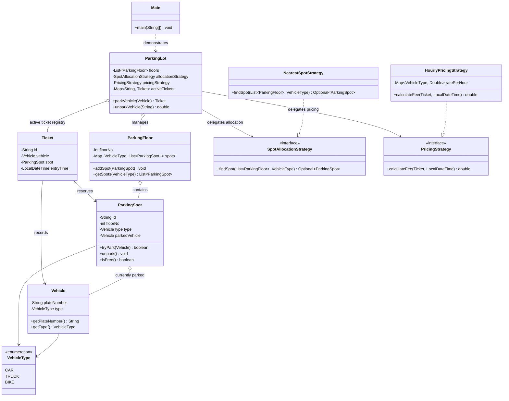
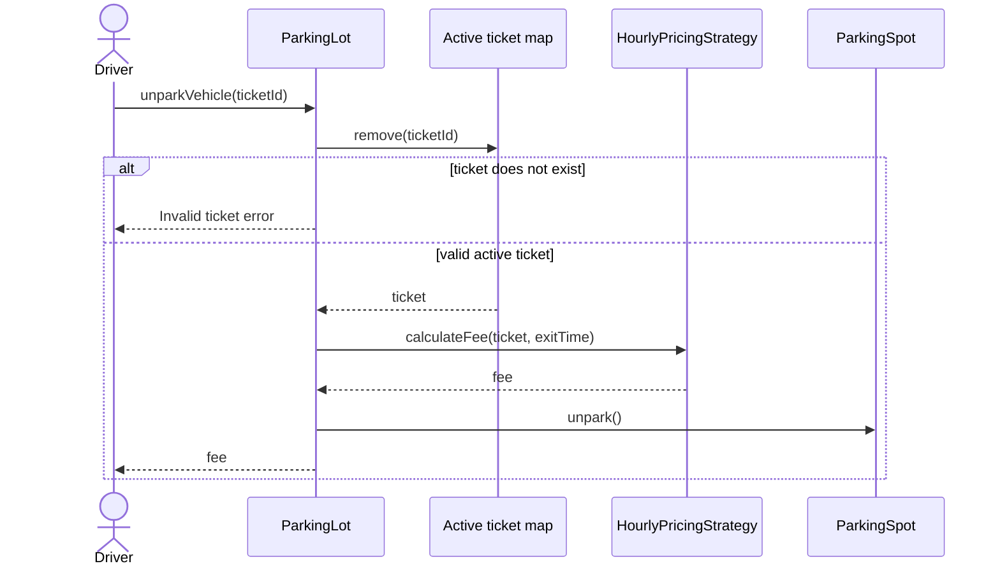
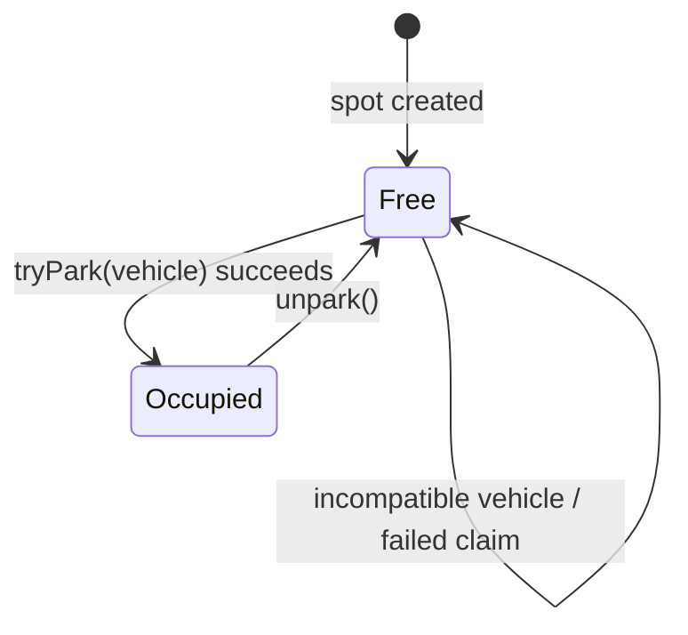

# Parking Lot — Low-Level Design

This folder contains a small, runnable Java implementation of a multi-floor parking lot. The example demonstrates object-oriented modeling, interchangeable policies, spot allocation, ticket lifecycle, and hourly pricing.

## Requirements and run

- Java 10 or newer (the example uses `List.of`, `Map.of`, and `List.copyOf`).
- From this directory, compile and run:

```text
javac ParkingLot.java
java Main
```

The demo creates one floor, parks a car, prints its ticket and spot, and checks the car out. The fee depends on how much time elapses between ticket creation and checkout; the minimum charge is one hour.

## Class responsibilities

| Class / interface | Responsibility |
| --- | --- |
| `VehicleType` | Supported vehicle categories: `CAR`, `TRUCK`, and `BIKE`. |
| `Vehicle` | Vehicle registration plate and category. |
| `ParkingSpot` | Spot identity, floor, compatible category, and synchronized occupancy operations. |
| `ParkingFloor` | Stores spots grouped by vehicle category. |
| `Ticket` | Unique ticket ID, vehicle, allocated spot, and entry time. |
| `SpotAllocationStrategy` | Contract for choosing a free compatible spot. |
| `NearestSpotStrategy` | Chooses the first free matching spot in floor/list order. |
| `PricingStrategy` | Contract for calculating a parking fee. |
| `HourlyPricingStrategy` | Charges a category-specific hourly rate, rounding a partial hour up. |
| `ParkingLot` | Coordinates entry, active tickets, pricing, and exit. |
| `Main` | Runnable demonstration. It is package-private because the source file is named `ParkingLot.java`. |

## Class diagram



## Entry sequence

```mermaid
sequenceDiagram
    actor Driver
    participant Lot as ParkingLot
    participant Allocator as NearestSpotStrategy
    participant Floor as ParkingFloor
    participant Spot as ParkingSpot
    participant Ticket

    Driver->>Lot: parkVehicle(vehicle)
    Lot->>Allocator: findSpot(floors, vehicle.type)
    Allocator->>Floor: getSpots(vehicle.type)
    Floor-->>Allocator: compatible spots
    Allocator->>Spot: isFree()
    Spot-->>Allocator: free status
    Allocator-->>Lot: Optional candidate
    Lot->>Spot: tryPark(vehicle)
    Note over Lot,Spot: tryPark is synchronized; competing cars cannot claim the same spot.
    Spot-->>Lot: success / failure
    Lot->>Ticket: create(vehicle, spot, entryTime)
    Lot->>Lot: store active ticket by ID
    Lot-->>Driver: ticket
```

If the candidate was claimed by another thread after the strategy inspected it, `tryPark` returns false and the lot retries up to three times. If no compatible free spot is found, entry fails with a `Parking full` error.

## Exit sequence



Removing a ticket from the active-ticket map means a ticket can be checked out only once. Checkout computes the price using the ticket's entry time and current exit time, then releases the spot.

## State flow



## Patterns used, and why

### Strategy pattern

`ParkingLot` depends on `SpotAllocationStrategy` and `PricingStrategy` interfaces, not the concrete algorithms. The demo injects `NearestSpotStrategy` and `HourlyPricingStrategy`. New policies can be added (for example, cheapest-first allocation or flat-rate pricing) by implementing the interface; the coordinator does not need to be rewritten. This is the primary design pattern in the example.

### Encapsulation and composition

Each class owns its related state: a floor groups spots, a spot owns occupancy, and a ticket captures one parking session. `ParkingLot` composes floors and policy objects rather than inheriting their behavior.

### Thread-safety measures

- `ParkingSpot.tryPark`, `unpark`, and `isFree` are synchronized so occupancy reads/writes use the spot's monitor.
- The active-ticket registry uses `ConcurrentHashMap` to support concurrent ticket access.
- Spot discovery and spot claiming are separate operations. The synchronized `tryPark` is the final authority; a failed claim is retried. In a high-contention production system, allocation could be improved with a centralized atomic claim or per-floor lock.

## Fee formula

For each vehicle category, the demo has an hourly rate. It rounds partial hours upward and applies a minimum one-hour charge:

$$
\text{hours} = \max\left(1, \left\lceil \frac{\text{stay minutes}}{60} \right\rceil\right)
$$

$$
\text{fee} = \text{hours} \times \text{rate per hour for vehicle type}
$$

Current rates are bike: 10, car: 20, and truck: 40 (currency units per hour). These are example values, not a payment integration.

## Important scope limits

This is an educational LLD example, not a production parking service. It uses exact vehicle-category matching and does not include reservations, payment processing, lost-ticket handling, spot-size compatibility rules, persistent storage, or a fee cap. It also treats the first spot in configured order as “nearest”; actual distance-based allocation would require location metadata and a different strategy.
